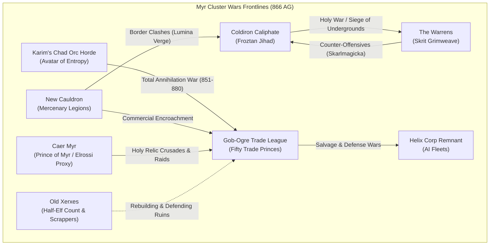
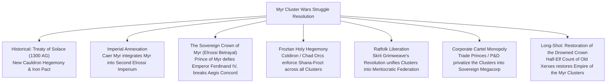

# The Myr Cluster Wars (866 AG Theatre Dossier)

**Primary File Reference:** [`docs/lore/NATIONS_AT_866_AG.md`](file:///c:/Users/river/Documents/GitHub/ck3.echoes.of.the.grip/docs/lore/NATIONS_AT_866_AG.md)  
**Bookmark Date:** 866 AG (Year 16 of the Myr Cluster Wars, 850–1300 AG)  
**Geographic Scope:** The Inset Wedge (The Outer Straits, Inner Straits, and the Core Myr Clusters)

---

## 1. Where to View the Master 866 Document

The comprehensive galactic catalog containing all 53 canonical nations, cosmologies, and timeline rulings is saved on your system at:
- **Local Absolute Path:** `C:\Users\river\Documents\GitHub\ck3.echoes.of.the.grip\docs\lore\NATIONS_AT_866_AG.md`
- **Markdown Link:** [`NATIONS_AT_866_AG.md`](file:///c:/Users/river/Documents/GitHub/ck3.echoes.of.the.grip/docs/lore/NATIONS_AT_866_AG.md)

---

## 2. Strategic Theatre Geometry (The Myr Wedge)

On the 866 AG Galactic Map, the Myr Clusters occupy the **Inset Wedge** in the upper-northeastern quadrant, connected to the galactic core by dense transit corridors and bordered by massive regional superpowers:

```
                          [Kwellick / Rustspire]
                                    |
                       [P&D Corporate Space]
                                    |
    [The Stellar Compact] <== The Outer Straits ==> [Cohorts of Thae'Viriel]
           |                                                |
   [Gob-Ogre Trade League]       << MYR WARZONE >>      [Coldiron Confederation]
   (50 Trade Princes)             (The Warrens,          (Froztan Caliphate)
                                  New Xerxes, Caer Myr,
                                  Karim's Invasion Front,
                                  Helix AI Remnants)
                                    |
                             [New Cauldron]
                                    |
                            [Concrete Cartel]
```

### The Three Spatial Zones of the Theatre
1. **The Inner Crucible (The Fractured Mosaic):** The dense cluster of worlds, orbital stations, and asteroid belts where ground wars, urban insurgencies, and proxy campaigns are actively raging.
   - Contested by **Old Xerxes (Half-Elf Survivors)**, **The Warrens**, **Caer Myr**, **Helix Corp Remnants**, and the rampaging path of **Karim Ibn Al Daveed**.
2. **The Flanking Superpowers (The War Titans):** The three massive territorial states attempting to swallow the Clusters whole:
   - **Gob-Ogre Trade League** (assaulting from the west).
   - **Coldiron Caliphate** (assaulting from the east).
   - **New Cauldron** (advancing from the southeast).
3. **The Straits Perimeter (The Profiteers & Observers):** The powers controlling the perimeter slipstreams, exploiting the war for scrap, labor contracts, and contraband:
   - **P&D Corporate Space** and **Kwellick** (guarding the northern transit neck).
   - **The Stellar Compact** (anxious western neighbor).
   - **Concrete Cartel** (southern scrap and smuggling pipelines).

> [!NOTE] Geographical Clarification: Old Xerxes vs. New Xerxes
> - **Old Xerxes:** The historic, water-scarred metropolis inside the Myr Cluster and the **de jure capital of the Empire of the Myr Clusters**. After the Water Oni and his full-elf followers were banished by a Campaign 3 player character, the waters receded, leaving its **Half-Elf citizens** to pick up the pieces and rebuild from the ruins.
> - **New Xerxes:** An independent haven located on an uninhabited world **outside** the Myr Clusters, founded in 851 AG after Corbin David detached **Dome 2** from Calix Corp's interstellar *Nimbus Ark*.

---

## 3. Operational Breakdown: What Each Nation is Doing & Should Be Up To in 866 AG



---

### A. The Direct Combatants (At War in 866 AG)

#### 1. Gob-Ogre Trade League (Fifty Trade Princes)
- **Current Situation in 866:** Existential catastrophe. Once the richest corporate power in the galaxy, their rapid early expansion (850 AG) has been utterly derailed:
  - **Karim's Horde** shattered the fortress world of Brasshold in 851 AG and has been systematically vaporizing League trade fleets with the *Leviathan Plate of Calamity*.
  - Fighting localized proxy battles against **Helix Corp's automated AI fleets** over disputed manufacturing drydocks.
  - Squeezed on their eastern flank by the **Prince of Myr** (who took Kaeltrix Station in 862 AG).
- **What They Should Be Doing (866–880 AG):**
  - **Desperate Defense:** Mass-contracting mercenaries from New Cauldron and the Hundred Stances to form defensive lines protecting their crown jewel, **Grand Kiln** (which canonically falls in 880 AG).
  - **Internal Intrigue:** The Fifty Princes should be actively scheming against one another—assassinating rivals on the board, embezzling remaining treasury reserves, and attempting to defect to P&D Corporate Space.
  - **Labor Suppression:** Crushing strike movements and goblin uprisings in remaining factory complexes before Karim reaches them.
- **CK3 Gameplay Hook:**
  - Starts in an active defensive war against Karim's horde.
  - Council mechanics with extreme faction disloyalty; unique decision to *"Emergency Sell Corporate Warrants"* for rapid mercenary funds.

#### 2. Karim Ibn Al Daveed (The Host of the Avatar of Entropy)
- **Current Situation in 866:** Halfway through his legendary 30-year rampage across the Gob-Ogre Trade League (851–880 AG).
  - Wielding the entropy-infused *Leviathan Plate of Calamity*, Karim leads disciplined Chad Orc legions that convert captured industrial worlds into ash and scrap.
  - Enslaving captured goblin engineers and artificers to build experimental entropy-decay siege weapons.
- **What He Should Be Doing (866–880 AG):**
  - **The Drive to Grand Kiln:** Methodically burning through outer League defensive lines to isolate and destroy the Grand Kiln industrial complex by 880 AG.
  - **Founding Froztan Settlements:** Establishing early military enclaves and imposing the Dhimmi taxation system on conquered goblin populations (the seed of the future Emirate of Yashuun).
  - **Preparing the Next Jihad:** Eyeing the technological riches of the Stellar Compact for his next campaign (beginning ~870–885 AG).
- **CK3 Gameplay Hook:**
  - Operates as a great conqueror horde with devastating event troops.
  - Unique CB: *Entropy Purge* (mass destruction of holding buildings in exchange for piety, prestige, and high-tier military loot).

#### 3. Coldiron Caliphate (The Myr Cluster Jihad)
- **Current Situation in 866:** In the ferocious middle phase of the **Myr Cluster Jihad (851–880 AG)** proclaimed by Caliph Muammar Al-David following the resurrection of Frozt.
  - Their cryo-armored crusader fleets swept into outer Myr, but are now heavily bogged down in brutal subterranean trench and tunnel warfare against **The Warrens**.
  - Facing border skirmishes with **New Cauldron** along the Lumina Verge transit corridor.
- **What They Should Be Doing (866–880 AG):**
  - **Subjugating the Ratfolk:** Trying to break the deadlock in the Warrens by deploying cryo-chemical weaponry, freezing subterranean cavern networks, and attempting to encircle Chitterholm.
  - **Securing Glacial Footholds:** Constructing fortified ice-citadels and imposing Froztan religious law across conquered Myr colonies.
  - **Preparing for Lumina Verge:** Mobilizing heavy armor formations along the border with New Cauldron to contest the lucrative mining systems (setting up the Battle of Lumina Verge in 885 AG).
- **CK3 Gameplay Hook:**
  - Active Holy War CB against The Warrens.
  - Unique *Cryo-Siege* mechanics reducing siege times in underground or mountain terrain; Froztan piety mechanics tied to converting conquered infidels.

#### 4. The Warrens (Skrit Grimweave's Revolution)
- **Current Situation in 866:** Deep in the crucible of **The Revolution (860–915 AG)**.
  - Led by **Skrit Grimweave** (legendary ratfolk magus and revolutionary), the trillions of ratfolk have overthrown their corrupt Txic'Er feudal overlords, capturing Greater Warren Klawhaven in 860 AG.
  - Currently fighting a desperate defensive war of survival against the invading **Coldiron Caliphate Jihad**.
  - Fielding scrap-welded war mechs, underground swarm tactics, and unleashing newly invented **Skarlmagicka** (unstable warp-fire and arcane ordnance).
- **What They Should Be Doing (866–880 AG):**
  - **Revolutionary Survival:** Defending core subterranean cities against Coldiron's cryo-legions using scorched-tunnel tactics, improvised explosives, and mass-levy swarms.
  - **Purging the Clan Loyalists:** Rooting out the lingering influence of the Txic'Er clan nobility and unifying all splinter warrens under Skrit's meritocratic command.
  - **Industrializing the Scrap:** Turning every captured scrap-yard and mining shaft into automated ammunition foundries.
- **CK3 Gameplay Hook:**
  - Revolutionary meritocracy government with near-limitless peasant levy reinforcement speed.
  - Unique *Skarlmagicka Inventions* lifestyle tree unlocking devastating experimental siege engines and combat buffs.

#### 5. Caer Myr / The Prince of Myr (The Elrossi Proxy)
- **Current Situation in 866:** High watermark of crusader prestige, but secretly on the brink of fracture.
  - Deployed covertly by Emperor Ferdinand IV of the Second Elrossi Imperium, the Prince of Myr rallied local human colonies and crusading Holy Orders.
  - Scored massive victories at the **Battle of Auric Belt (855 AG)** and the **Siege of Kaeltrix Station (862 AG)**, seizing vital trade choke points from the Gob-Ogre League.
- **What He Should Be Doing (866–880 AG):**
  - **Fortifying Bastion Halreth:** Consolidating garrisons at Bastion Halreth to defend against counter-offensives (where the disastrous Fall of Bastion Halreth occurs in 868 AG).
  - **Hunting Divine Relics:** Obsessively allocating military funds and elite scouts into deep Myr ruins to search for lost relics of the "First of the Third".
  - **Managing Holy Order Dogma:** Struggling to prevent rival Elrossi Holy Orders from breaking into sectarian infighting over religious doctrine.
- **CK3 Gameplay Hook:**
  - Tributary / Marcher realm of the Second Elrossi Imperium.
  - Holy Order cohesion meter: failing to maintain consensus causes Holy Orders to withdraw troops and pursue independent wars.

#### 6. New Cauldron (The Mercenary Directorate)
- **Current Situation in 866:** Ascendant, hyper-efficient, and expanding.
  - Operating under an irreligious, cyberpunk philosophy, New Cauldron views the Myr Cluster Wars as the ultimate commercial and territorial opportunity.
  - Swelling its ranks by offering the **"Success Clause"** contract—lucrative profit-sharing and land warrants that attract elite mercenaries from across the galaxy.
- **What They Should Be Doing (866–880 AG):**
  - **Commercial Infiltration:** Buying up bankrupt Gob-Ogre corporate debt, seizing orphaned orbital hubs, and deploying Mercenary Legions to secure resource nodes.
  - **Border Skirmishes:** Harassing Coldiron Caliphate supply convoys along the Lumina Verge corridor, steadily escalating toward the full-scale conflict of 885 AG.
  - **Recruiting Disillusioned Veterans:** Offering citizenship and cybernetic augmentations to deserters, defecting goblin artificers, and ronin warriors.
- **CK3 Gameplay Hook:**
  - Empire-tier corporate directorate with access to unique *Mercenary Legion* standing armies with reduced upkeep.
  - Can purchase territorial claims directly with gold via corporate buyout decisions.

#### 7. Helix Corp Remnant
- **Current Situation in 866:** Algorithmic defensive survival.
  - Old Xerxes drowned in 850 AG, destroying Helix Corp's executive board. Surviving automated AI networks under **Executive Core Clayd** continue to execute standing operational orders.
  - Fielding automated drone fleets and AI defense flotillas across surviving factory moons.
- **What They Should Be Doing (866–880 AG):**
  - **Asset Preservation:** Defending automated server-stations and terraforming arrays from Gob-Ogre scrap crews and New Cauldron salvagers.
  - **Data Scrubbing:** Purging compromised research protocols and protecting legacy terraforming algorithms (which New Cauldron eventually recovers in later centuries).
- **CK3 Gameplay Hook:**
  - Autonomous AI flotilla realm. No marriages/dynasty (succession via executive protocol); fields zero-levy, all-automated Men-at-Arms.

#### 8. County of Old Xerxes (Half-Elf Scrappers & Survivors)
- **Title / Holding:** `c_old_xerxes` — **De Jure Capital of the Empire of the Myr Clusters (`e_myr_clusters`)**.
- **Government & Ruler:** Half-Elf Count / Local Magistrate.
- **Situation in 866 AG:**
  - Old Xerxes was the historic crown jewel of the Myr Cluster before being inundated and drowned in 850 AG by an empowered Water Oni.
  - In canon, the Water Oni and his full-elf followers were **banished** by one of the Campaign 3 player characters (with a game-start event determining which hero enacted the banishment).
  - Following the banishment, the supernatural waters receded, revealing the mud-soaked ruins, drowned towers, and rusted infrastructure.
  - While corporate evacuees fled aboard the *Nimbus Ark* (later forming New Xerxes elsewhere), the remaining **Half-Elf citizens of Old Xerxes** were left behind to pick up the scraps, salvage what remained, and rebuild their shattered metropolis amidst the raging Myr Cluster Wars.
- **What They Should Be Doing (866–880 AG):**
  - **Rebuilding from the Silt:** Pumping out flooded subterranean vaults, clearing silt from ancient high-tech workshops, and repairing shattered orbital defenses.
  - **Defending the Ruins:** Fending off rapacious Gob-Ogre scavengers, Helix AI sweepers, and roving Chad Orc raiders trying to plunder the historic capital's treasures.
  - **Preserving Ancestral Pride:** Resisting foreign annexation from Caer Myr crusaders and New Cauldron corporate recruiters, aiming to reclaim their rightful status as masters of the Clusters.
- **CK3 Gameplay Hook:**
  - Playable Count-tier realm in the heart of the warzone.
  - Starting county modifier: *Receding Floodwaters & Scrapper Resurgence* (increased building cost, but high scrap revenue and discovery chance for lost artifacts).
  - Special game-start narrative event: *"The Banishment of the Tide-Crowned"*, selecting which Campaign 3 hero banished the Water Oni.
  - Primary candidate for the ultimate underdog / long-shot Struggle Ending!

---

### B. The Frontline Haven & Frontier Opportunists

#### 8. New Xerxes (Corbin David) — *External Frontier Haven*
- **Current Situation in 866:** Independent haven located on an uninhabited world **outside** the Myr Clusters.
  - After Old Xerxes drowned in 850 AG, Corbin David detached **Dome 2** from Calix Corp's *Nimbus Ark* in 851 AG, establishing the city-state under the **Silent Law Charter** (forbidding any outside corporation from owning it).
- **Relationship to the Myr Wars:**
  - While not geographically in the Clusters, New Xerxes acts as an off-the-books commercial nexus: laundering loot for fleeing Gob-Ogre executives, smuggling black-market stimms and cybernetics to New Cauldron sellswords, and exporting gambling and luxury vices across the galaxy.
- **CK3 Gameplay Hook:**
  - External non-struggle trade haven with special decision interactions to trade with or finance factions inside the Myr Struggle.

#### 9. Concrete Cartel
- **Current Situation in 866:** Southern perimeter scrap dominance.
  - Goblin scrap bosses and salvage syndicates operating along the southern fringe of the Myr Wars.
- **What They Should Be Doing (866–880 AG):**
  - **Consolidating the Scrap Trade:** Drafting the **Ashen Compact (870 AG)** to establish a monopoly over all battlefield scrap and titanium salvaged from Myr orbital wrecks.
  - **Clashing with Pillwake:** Fighting off narcotic smuggling infiltration by Pill Mob capos trying to push into Cartel space.
- **CK3 Gameplay Hook:**
  - Syndicate realm whose tax revenue increases dynamically based on the total war casualties in neighboring Myr provinces.

#### 10. Kwellick Nation
- **Current Situation in 866:** The Scrappers' Golden Age.
  - Centered on the colossal orbital scrapyard capital of **Rustspire Station**, directly controlling northern access to the Outer Straits.
- **What They Should Be Doing (866–880 AG):**
  - **Refining War Salvage:** Dismantling shattered warships from the Gob-Ogre/Karim clashes and selling refurbished hulls to whoever has gold.
  - **Fending Off Chad Orc Scouts:** Keeping Rustspire Station's defensive turrets on high alert against roaming raiders.
- **CK3 Gameplay Hook:**
  - Scrapper clan government with bonuses to starport holding development and artifact recovery.

#### 11. P&D Corporate Space
- **Current Situation in 866:** High-level corporate exploitation from the north.
  - Sits at the northern gate of the Outer Straits, watching the war unfold.
- **What They Should Be Doing (866–880 AG):**
  - **Predatory Lending:** Offering massive loans, licit cybernetics, and heavy chassis to the Fifty Trade Princes in exchange for long-term orbital mining concessions.
  - **Preparing the Duergar Accord:** Laying the groundwork for the 900 AG Duergar labor contract to replace decimated workforce populations in the Straits.
- **CK3 Gameplay Hook:**
  - Mega-corporation that can issue "Debt Traps" to warring realms, gaining vassalage or treaty rights if they default.

#### 12. The Stellar Compact
- **Current Situation in 866:** Nervous western neighbor.
  - A dieselpunk industrial coalition bordering the western approaches to the Myr Clusters.
- **What They Should Be Doing (866–880 AG):**
  - **Border Fortification:** Anxiously watching Karim Ibn Al Daveed dismantle the Gob-Ogre League next door.
  - **Preparing for Invasion:** Unbeknownst to them, Karim's legions will turn directly upon their research hub of Velara Prime in the 870s/880s, leading to their catastrophic collapse and the founding of the Emirate of Ghurzhem.
- **CK3 Gameplay Hook:**
  - Industrial defensive realm with event chains signaling the approaching storm of Karim's entropy crusade.

---

## 4. The Myr Cluster Wars Struggle Mechanics (CK3 Design)

In Crusader Kings 3, the Myr Cluster Wars is implemented as an active **Struggle System** (`eotg_struggle_myr_cluster_wars`):

### Struggle Parameters at 866 AG
- **Starting Phase at 866 AG:** **Hostility Phase** (The Early Clashes, 850–890 AG).
- **Involved Cultures:**
  - Goblin / Ogre (Gob-Ogre League, Concrete Cartel, Kwellick)
  - Chad Orc (Karim's Horde, Coldiron Caliphate)
  - Ratfolk (The Warrens)
  - Cyber-Human / Augmented (New Cauldron)
  - Elrossi (Caer Myr)
- **Involved Faiths:**
  - Froztlamic (Coldiron, Karim's Host)
  - Corporate Irreligious / Technocratic (New Cauldron, P&D)
  - Elrossi Orthodox (Caer Myr)
  - Skarlmagick Cults (The Warrens)
  - Baphometic / Mammonite (Gob-Ogre League)

### Phase Progression & Catalysts
1. **Hostility Phase (Current in 866):**
   - High CB discounts for religious conquests and corporate raids.
   - Devastation in holdings increases drastically from sieges.
   - Heavy penalties to inter-faith and inter-culture diplomacy.
2. **Escalation / Polarization Phase (880–950):**
   - Triggered by the Fall of Grand Kiln (880) and Battle of Lumina Verge (885).
   - Holy Orders and Mercenary Companies gain immense recruitment buffs.
   - Smaller city-states forced to pledge fealty to major regional factions.
3. **Exhaustion / Quagmire Phase (1000–1200):**
   - Decades of protracted siege warfare turn the Clusters into an attritional meat-grinder.
   - High war weariness, mercenary mutinies, and plague events.
4. **Resolution Phase (Struggle Endings):**



#### Detailed Ending Decisions

1. **Historical Ending: The Treaty of Solace (New Cauldron Victory)**
   - *Requirement:* Controlled by New Cauldron or allied mercenary directorate.
   - *Outcome:* Consolidates the Iron Pact; turns the Clusters into an irreligious cyberpunk industrial powerhouse.

2. **The Sovereign Crown of Myr (The Elrossi Betrayal)**
   - *Concept:* The Prince of Myr turns his back on Emperor Ferdinand IV, declaring that blood shed in the Clusters belongs to the soldiers of Caer Myr, not the golden spires of Elyria.
   - *Requirement:* Held by an Elrossi ruler in Caer Myr; breaks the *Aegis Concord*; achieves complete regional supremacy.
   - *Outcome:* Dissolves vassalage/tributary status to the Second Elrossi Imperium; creates an independent, sovereign feudal **Empire of Myr**; triggers an imperial excommunication and permanent rivalry with the von Sternstahl dynasty.

3. **Imperial Annexation (The Loyal Elrossi Victory)**
   - *Requirement:* Caer Myr conquers the Clusters while maintaining high loyalty to Emperor Ferdinand IV.
   - *Outcome:* The Myr Clusters become a formal de jure Imperial March of the Second Elrossi Imperium.

4. **Froztan Holy Hegemony (The Jihad Triumphant)**
   - *Requirement:* Held by Coldiron Caliphate or a Chad Orc emirate.
   - *Outcome:* Enforces Sharia-Frozt across all orbital habs; cleanses cybernetics; consecrates glacial cathedrals.

5. **Ratfolk Liberation (Skrit's Meritocratic Dream)**
   - *Requirement:* The Warrens survives and expels all foreign invaders.
   - *Outcome:* Unifies the Clusters into a revolutionary, meritocratic socialist confederacy powered by mass automation and Skarlmagicka.

6. **Corporate Cartel Monopoly**
   - *Requirement:* Held by the Fifty Trade Princes, Concrete Cartel, or P&D.
   - *Outcome:* Liquidates sovereign feudal and religious titles; creates the ultimate privatized megacorporation where rights are sold as shares.

7. **The Long-Shot Ending: Restoration of the Drowned Crown (Half-Elf Count of Old Xerxes)**
   - *Background & Lore:* **Old Xerxes** was the historic metropolis of the Myr Cluster and remains the **de jure capital of the Empire of the Myr Clusters**. Flooded in 850 AG by an empowered Water Oni, the Oni and his full-elf followers were canonically **banished** by one of the Campaign 3 player characters (with a game-start event determining which hero banished them). The floodwaters receded, leaving the **Half-Elf citizens of Old Xerxes** behind to pick up the scraps and rebuild from the waterlogged ruins and mud.
   - *Concept:* Rising from the waterlogged ruins against impossible odds, the Half-Elf Count out-survives the corporate titans, Chad Orc invaders, and imperial crusaders to reclaim their ancestral home.
   - *Requirement:* Held by the Half-Elf Count/ruler of Old Xerxes; fully rebuilds the Old Xerxes holding; expels or subjugates all foreign invaders from the core cluster; achieves struggle dominance.
   - *Outcome:* Formally restores and crowns the sovereign **Empire of the Myr Clusters** with Old Xerxes as its restored imperial capital; permanently humbles the mega-corporations and holy orders; grants high cultural and religious tolerance traits to the surviving half-elf populace.
   - *(Additional minor lord / underdog endings will be incorporated as development continues).*
