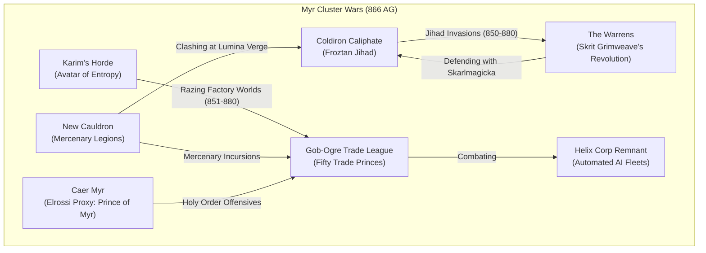
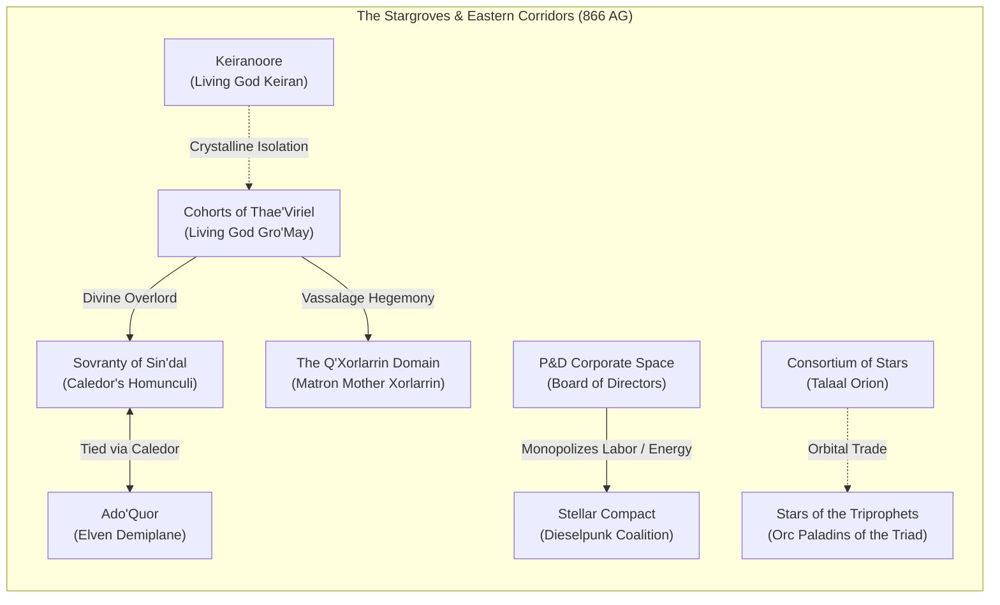
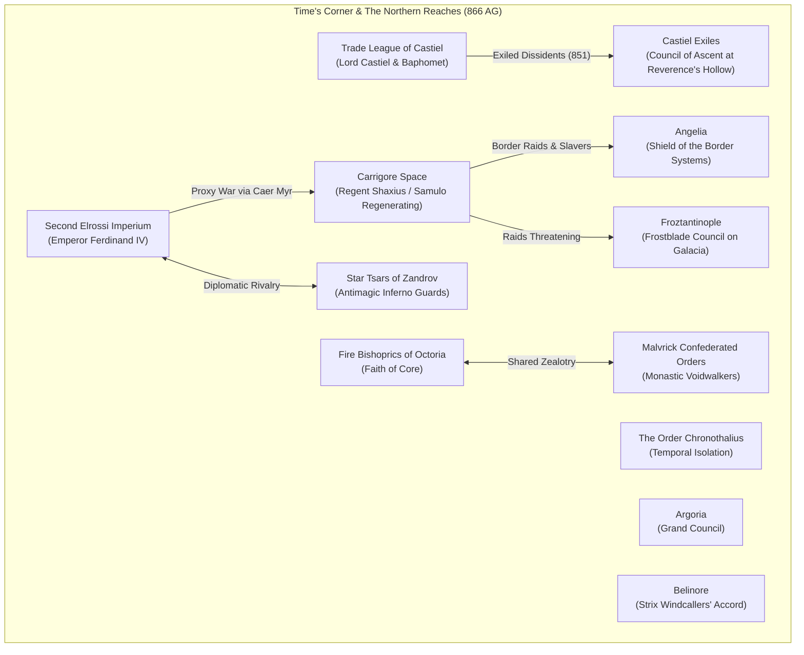
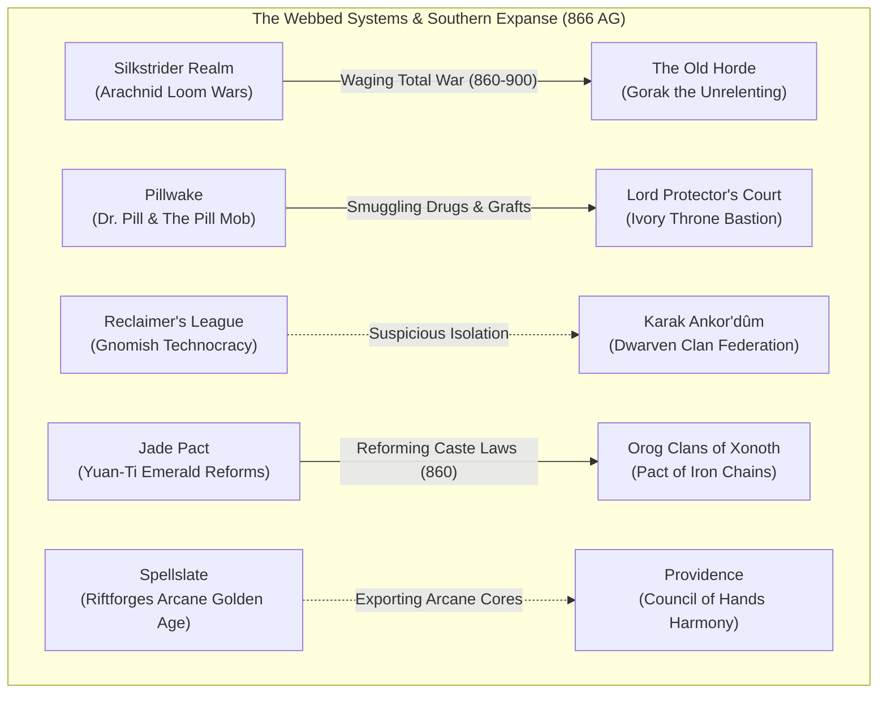
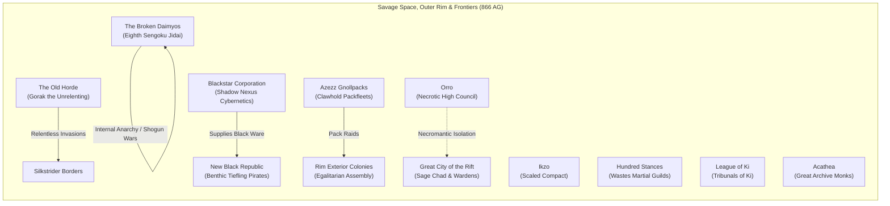

# The Galaxy at 866 AG: Geopolitical Landscape and Nation Catalog

**Bookmark Date:** 866 AG (Aftermath Era, Year 16 of the Third Era Post-Crucible Shattering)  
**Historical Context:** 15–16 years following the **Rift Ruptures (850–851 AG)**, the destruction of the Crucible of the Rift by Zer'kaath the Broken Star, and the drowning of Old Xerxes. The galactic arena is defined by the opening decades of the **Myr Cluster Wars (850–1300 AG)**, violent ideological confrontations, corporate resource consolidation, and the ongoing **Titan Exodus (begun 131 AG)**.

---

## 1. Setting Framework & Rules of the Era (866 AG)

Before assessing individual realms, the following fundamental axioms govern the galaxy in 866 AG:

1. **Galactic Stage, Not a Single Planet:** The setting is an interstellar galaxy connected by slipstreams, star-gates, arcane corridors, and sub-light trade lanes. The term *world* applies strictly to literal planets. Factions operate across star systems, asteroid bastions, orbital void-citadels, and demiplanes.
2. **Absence of Supra-National Authority:** There is **no Galactic League** (informal talks begin only in ~1650 AG; charter signed in 1750 AG). The **Archivist Dominion of Acathea** has just founded its Great Archive (851 AG) and does **not** arbitrate interstellar law until the *Codex Unbound* (950 AG). Law is strictly enforced at the polity border.
3. **The Titans and the Cosmology:**
   - **Yu** (the pale dragon titan, imprisoned in the Dream) and **Orrin** (the chained magma titan, imprisoned in the Void) are the **only two true Titans**. Neither has any known origin.
   - **Carrigore** was born from the shattered celestial Blade that contained Yu's essence; Carrigore is an aspiring fledgling deity seeking Titan rank.
   - **Prison Planes:** Countless self-contained extradimensional prisons exist (*"The universe contains countless prisons. Nobody notices the successful ones"*). The Dream, the Void, and the Rift are infamous because their containment failed. The Rift sits between Dream and Void (`Dream -> Rift -> Void`). Slain or banished gods within the Rift cycle through *death -> dissolution -> regeneration/rebirth -> death*.
4. **Commercialized Augmentation:** Cybernetics and arcane grafts are rampant, unregulated, and corporate-driven. **Blackstar Corporation** dominates black-market military augmentations; **P&D Corporate Space** holds licit labor and heavy-chassis monopolies; **Calix** provides bioware and nanotech medical contracts; **Pillwake** trades in soul-binding organic grafts.
5. **Dated Timeline Precedence:** Where undated summary sections in historical records mention future formations (such as League membership or 10th-century treaties), the dated annals take precedence. Polities formed after 866 AG do not exist on the map and are documented in Section 7 as emergent nations.

---

## 2. Theatre I: The Myr Clusters (Inner & Outer Myr)

The Myr Clusters are the most volatile, resource-rich, and heavily contested warzone in known space. The **Myr Cluster Wars (850–1300 AG)** are in their ferocious opening phase (the *Hostility / Early Expansion Phase*).

### 1. Gob-Ogre Trade League (Fifty Trade Princes)
- **Status at 866:** Canonical Realm (`e_gob_ogre_league`).
- **Capital / Seat:** High Board Spire, Gilded Foundries of Karkesh.
- **Government & Ruler:** Corporate Plutocracy / Oligarchy; governed by the **Council of Fifty Trade Princes** (compromise between Goblin corporate moguls and Ogre industrial barons under the Charter of Fifty).
- **Situation in 866 AG:** Desperate existential crisis. Having seized vast territories in the Clusters at the war's outbreak (850 AG), the League is now suffering devastating defeats on two fronts:
  - **Karim Ibn Al Daveed's Chad Orc Jihad** struck in 851 AG, razing core fortress worlds like Brasshold with the *Leviathan Plate of Calamity* and systematically destroying League trade fleets.
  - Skirmishing continuously with **Helix Corp's automated AI fleets** over industrial manufacturing infrastructure.
  - Internal rot: The Trade Princes are actively assassinating one another, sabotaging rival board members, and hoarding private mercenary armies rather than presenting a unified front.
- **Immediate Threats & Goals:** Halt Karim's advance before he reaches the industrial jewel of **Grand Kiln** (which falls in 880 AG); secure desperate loans from P&D Corporate Space; suppress goblin laborer revolts in secondary foundries.
- **CK3 Implementation:** Imperial tier merchant republic/corporate oligarchy. Starting defensive war against Karim's host; heavy penalization to council loyalty; unique corporate mercenary contract mechanics.

### 2. New Cauldron
- **Status at 866:** Canonical Realm (`e_new_cauldron`).
- **Capital / Seat:** The Spire of Foundries, Cauldron Prime.
- **Government & Ruler:** Cyberpunk Directorate / Exploratory Republic; governed by the **Directorate Council** and high-ranking fleet captains, with military operations directed by **Legate Darius Varron**.
- **Situation in 866 AG:** Rapid, ascendant expansion. Operating under an irreligious, hyper-pragmatic ethos, New Cauldron is surging into the Myr Clusters.
  - Employing massive **Mercenary Legions** bound by the lucrative "Success Clause" contract, swelling ranks with veteran sellswords and shock cyborgs.
  - Engaging in fierce brush wars against Coldiron Caliphate zealots along the border systems (building toward the major clash at Lumina Verge in 885 AG).
  - Deploying exploratory fleets into deep salvage zones left by the Rift Ruptures.
- **Immediate Threats & Goals:** Carve out mineral extraction conduits across Outer Myr; counter the religious crusades of both Coldiron and the Elrossi Holy Orders; recruit disillusioned defectors from the crumbling Gob-Ogre League.
- **CK3 Implementation:** Empire tier militarized corporate republic. Access to the "Success Clause" mercenary hiring decision (reduced mercenary upkeep, increased combat prowess); unique *Vault Stance* shock troops.

### 3. Coldiron Caliphate
- **Status at 866:** Canonical Realm (`e_coldiron_caliphate`).
- **Capital / Seat:** The Frost Citadel of Qalaat-al-Thalj.
- **Government & Ruler:** Theocratic Caliphate (Froztlamic); ruled by **Caliph Muammar Mohammed Abu Minyar Al-David**.
- **Situation in 866 AG:** Zealous military expansion. Following the mysterious revival of **Frozt** during the 850 Rift Ruptures, the Caliph proclaimed the **Myr Cluster Jihad** in 851 AG.
  - Caliphate cryo-armored crusader fleets have swept into Outer Myr, establishing glacial beachheads on mineral worlds.
  - Currently bogged down in brutal, attritional urban and subterranean warfare against the ratfolk of **The Warrens**.
  - Facing rising hostility from New Cauldron along the Lumina Verge corridor.
- **Immediate Threats & Goals:** Crush the ratfolk rebellion of Skrit Grimweave; purge "heathen" cybernetic enclaves; establish Sharia-Frozt across all captured orbital habs.
- **CK3 Implementation:** Empire-tier theocracy/feudal caliphate. Active holy war CB against the Warrens and Myr border states; unique *Cryo-Zealot* Men-at-Arms; mechanic for managing the *Froztan Inquisitions*.

### 4. The Warrens
- **Status at 866:** Canonical Realm (`k_the_warrens`).
- **Capital / Seat:** Chitterholm (Lower Undercity Hubs).
- **Government & Ruler:** Revolutionary Meritocracy / Insurgent Collective; led by **Skrit Grimweave** (genius magus, inventor, and revolutionary warlord) contesting the feudal **Txic'Er Clan Overlords**.
- **Situation in 866 AG:** Engulfed in **The Revolution (860–915 AG)**.
  - In 851–860 AG, Skrit broke the stranglehold of the hereditary Txic'Er ratfolk nobility, seizing Greater Warren Klawhaven in 860 AG.
  - Fighting a multi-front total war: defending the Warrens' trillions of ratfolk against the invading **Coldiron Caliphate Jihad**, while simultaneously purging reactionary loyalist ratfolk clans.
  - Fielding scrap-welded war machines, subterranean swarms, and unleashing newly engineered **Skarlmagicka** (warp-tech spellcraft and heavy artillery).
- **Immediate Threats & Goals:** Break the encirclement of Coldiron's cryo-legions; unify the scattered subterranean deep-warrens; expand automated factory scrap-lines.
- **CK3 Implementation:** Kingdom tier revolutionary regime. High levy reinforcement rates; unique *Skarlmagicka* lifestyle focus or inventions; defensive combat advantages in urban/underground holdings.

### 5. New Xerxes (External Frontier Haven)
- **Status at 866:** Canonical City-State / Realm (`d_new_xerxes` / `k_new_xerxes`).
- **Capital / Seat:** Dome 2 (The Detached Biosphere), World of Solace (Located outside the Myr Clusters).
- **Government & Ruler:** Autocratic Free Port / Syndicate Board; led by **Corbin David** (charismatic founder and Commander of Dome 2).
- **Situation in 866 AG:** Fragile pioneer era of vice and survival.
  - Old Xerxes was an influential city inside the Myr Cluster that drowned beneath the tides in 850 AG (conjured by an empowered Water Oni). The survivors evacuated aboard Calix Corp's interstellar *Nimbus Ark*.
  - In 851 AG, Corbin David led a bloody rebellion aboard the Ark against Calix authoritarian rationing, detaching **Dome 2** and crash-landing upon an uninhabited world located **outside the Myr Clusters**.
  - Operating under the creed *"Excess is our export,"* Corbin David is turning the city-state into an unregulated haven of casinos, contraband bazaars, black-market augments, and pleasure dens (the precursor to the Sin Sectors).
  - Protected by the newly penned **Silent Law Charter** (forbidding any outside mega-corporation from claiming sovereign ownership).
- **Immediate Threats & Goals:** Maintain independence from Calix Corp retribution fleets; survive through high-margin trade and laundering; keep criminal syndicates from overthrowing Corbin's direct rule.
- **CK3 Implementation:** Duchy/Kingdom tier merchant haven. Huge tax bonuses from trade and vices; diplomatic protection traits; immune to standard embargoes.

### 6. Caer Myr (Proxy of the Second Elrossi Imperium)
- **Status at 866:** Regional Proxy Realm (`k_caer_myr`).
- **Capital / Seat:** Caer Myr (Fortress-Station Asteroid).
- **Government & Ruler:** Feudal Crusader Lordship; ruled by the **Prince of Myr** (a devout, charismatic Elrossi prince backed clandestinely by Emperor Ferdinand IV).
- **Situation in 866 AG:** Height of crusader ascendancy before internal fractures.
  - Deployed by the Second Elrossi Imperium to fight in the Myr Clusters without entangling the imperial parliament in a formal war.
  - Scored massive victories at the **Battle of Auric Belt (855 AG)** and the **Siege of Kaeltrix Station (862 AG)**, smashing Gob-Ogre convoys and seizing critical shipping corridors.
  - However, in 866 AG, cracks are forming: crusading Holy Orders are bickering over theological dogma, and the Prince is spending exorbitant funds hunting for ancient relics of the "First of the Third" (leading toward the disaster at Bastion Halreth in 868 AG).
- **Immediate Threats & Goals:** Fortify Bastion Halreth against counter-attacks; maintain unity among feuding Holy Orders; secure the eastern transit routes into Elrossi space.
- **CK3 Implementation:** Kingdom-tier holy order tributary / crusader state. Vassal or tributary to the Second Elrossi Imperium; special *Holy Order Cohesion* mechanic.

### 7. Helix Corp Remnant
- **Status at 866:** Non-Territorial / Autonomous Flotilla Actor (`d_helix_remnant`).
- **Seat / Operations:** Automated Orbital Drydocks, Sector 4-B (Scattered Myr Orbitals).
- **Government & Ruler:** Corporate Artificial Intelligence Network / Executive Core Clayd.
- **Situation in 866 AG:** Desperate algorithmic survival.
  - Following the catastrophic flooding of Old Xerxes and the destruction of Helix Headquarters in 850 AG, the corporate leadership dissolved.
  - The remnant fields **automated AI fleets** that patrol surviving factory stations and deep-space data vaults across the Myr Clusters.
  - Engaged in constant skirmishes with Gob-Ogre salvage scavengers and New Cauldron scrap-teams trying to harvest Helix terraforming algorithms.
- **Immediate Threats & Goals:** Protect remaining automated server-moons; prevent corporate espionage; maintain power grid connectivity.
- **CK3 Implementation:** Special corporate/flotilla title. Access to high-tier automated warfleet Men-at-Arms; target of raiding by neighboring powers.

### 8. Karim's Horde / Host of the Avatar of Entropy
- **Status at 866:** Nomadic Conqueror Host / Invading Warband (`e_avatar_of_entropy`).
- **Leader:** **Karim Ibn Al Daveed** (The Avatar of Entropy, Warlord of the Chad Orcs).
- **Situation in 866 AG:** In the mid-stage of his 30-year rampage against the Gob-Ogre Trade League (851–880 AG).
  - Wielding the legendary *Leviathan Plate of Calamity*, Karim's legions have shattered Brasshold and the Verdant Straits.
  - Currently besieging, raiding, and dismantling League industrial assets across the mid-Myr corridor, preparing for his eventual march on Grand Kiln (880 AG).
  - Enslaving captured goblin artificers to develop experimental entropy-decay weapons.
- **Immediate Threats & Goals:** Complete the annihilation of the Fifty Trade Princes; enforce the Froztan creed through raw destruction; prepare for future holy crusades against the Stellar Compact (870s) and Elross (930s).
- **CK3 Implementation:** Nomad / Great Conqueror horde with massive initial event troops; unique *Avatar of Entropy* trait giving terrifying dread and siege speed.

### 9. Concrete Cartel
- **Status at 866:** Canonical Realm (`k_concrete_cartel`).
- **Capital / Seat:** The Slag Spires of Oakhaven (Former Varrak Salvage Core).
- **Government & Ruler:** Syndicate Plutocracy; governed by the **Under-Bosses of the Concrete Board**.
- **Situation in 866 AG:** Golden age of scrap smuggling and illicit salvage.
  - Operating across the border sectors between Myr and the southern expanse, the Cartel strips down ruined titan-chassis and Second Era wrecks.
  - Preparing for the formalization of the **Ashen Compact (870 AG)** to monopolize black-market raw alloy transport.
  - Clashing with Pillwake enforcers and New Cauldron salvage scouts over newly uncovered scrap belts.
- **Immediate Threats & Goals:** Defend trade corridors against Pill Mob narcotics infiltration; monopolize scrap routes feeding the Myr war efforts.
- **CK3 Implementation:** Syndicate / criminal enterprise government. Income scaling with nearby war devastation; high supply limit in ruined holdings.

### 10. Kwellick Nation
- **Status at 866:** Canonical Realm (`k_kwellick`).
- **Capital / Seat:** Rustspire Station (Massive Orbital Scrapyard Hub).
- **Government & Ruler:** Scrapper Clan Coalition; governed by the **Council of High Scrappers**.
- **Situation in 866 AG:** Scrappers' Golden Boom.
  - In 851 AG, the Scrappers' Clans achieved interstellar political ascendance, centralizing operations around Rustspire Station.
  - Thriving by processing war wreckage from the Myr Cluster Wars, refining rare Second Era hyper-alloys, and selling hybrid tech to whoever pays in platinum.
- **Immediate Threats & Goals:** Protect Rustspire from Chad Orc raiding parties; prevent pirate cartels from commandeering deep-salvage wrecks.
- **CK3 Implementation:** Scavenger clan government; bonuses to station development and artifact production from salvage.

---

## 3. Theatre II: The Stargroves & Eastern Corridors

The ancient home of the High Elven Cohorts, sprawling corporate systems, and enigmatic prophetic federations.

### 11. Cohorts of Thae'Viriel
- **Status at 866:** Canonical Realm (`e_thae_viriel`).
- **Capital / Seat:** The Living Grove-Citadel of Viriel Prime.
- **Government & Ruler:** Divine Hegemony / Autocracy; ruled openly by the **Living God Gro'May** through his **Eternal Court**.
- **Situation in 866 AG:** Re-stabilized divine dominion.
  - Following the chaos of the 850 Rift Ruptures, Gro'May's Eternal Court fully reasserted imperial authority in 851 AG.
  - Enforces strict elven supremacy and vassalage over neighboring elven realms (the Sovranty of Sin'dal and the Q'Xorlarrin Domain).
  - The *Celestial Rift Defense* system is placed on maximum alert, monitoring planar tear frequencies across the Eastern Void.
- **Immediate Threats & Goals:** Prevent non-elven border encroachment; enforce religious devotion to Gro'May; prepare for the proclamation of the Astral Edict of Dominion (900 AG).
- **CK3 Implementation:** Empire-tier divine theocracy. Gro'May possesses immortal traits/godhood modifier; high vassal control; powerful Elven Star-Warden Men-at-Arms.

### 12. Sovranty of Sin'dal
- **Status at 866:** Canonical Realm (`k_sindal`).
- **Capital / Seat:** The Spire of Sin'dal, Grove of Glass.
- **Government & Ruler:** Hierophantic Magocracy; governed on paper by **Caledor Sin'dal**, administered day-to-day by his network of soul-linked **Homunculi** under the **Hierophant's Directive (851 AG)**.
- **Situation in 866 AG:** Autonomous elven vassal-state of the Cohorts of Thae'Viriel.
  - Thriving economy focused on mana redistribution, celestial tools, and arcane navigation matrices.
  - Caledor's homunculi maintain rigid bureaucratic stability, ensuring strict adherence to Gro'May's edicts while quietly pursuing esoteric planar experiments connecting to Ado'Quor.
- **Immediate Threats & Goals:** Avoid being drawn directly into the Myr Wars; safeguard the secret conduits to Ado'Quor; expand the guild monopolies of celestial tools.
- **CK3 Implementation:** Kingdom-tier magocracy / vassal to `e_thae_viriel`. Special homunculus council mechanics preventing succession crises.

### 13. Ado'Quor
- **Status at 866:** Canonical Realm / Demiplane (`e_ado_quor`).
- **Capital / Seat:** The Golden Glades of Core-Quor.
- **Government & Ruler:** Demiplane Utopia / Theocracy; ruled by **Caledor Sin'dal** in his divine ascendant persona.
- **Situation in 866 AG:** Pocket-dimension sanctuary locked in metaphysical struggle.
  - A demiplane the size of a minor galaxy, created as a sanctuary where elves dwell in supposed eternal harmony.
  - Behind the idyllic facade, Ado'Quor is locked in an endless, cyclical war of reincarnation against the encroaching undead manifestations of **Vy'esh** (the god of death).
- **Immediate Threats & Goals:** Seal planar breaches through which Vy'esh's rot infiltrates the outer glades; preserve the souls of fallen elves within the Great Lattice.
- **CK3 Implementation:** Special isolated demiplane realm. High development; unique reincarnation / soul-well mechanics; periodic necrotic horde invasions.

### 14. Keiranoore
- **Status at 866:** Canonical Realm (`k_keiranoore`).
- **Capital / Seat:** The Crystal Throne of Keir Prime.
- **Government & Ruler:** Divine Monarchy; ruled openly by the **Living God Keiran the Crystal One**.
- **Situation in 866 AG:** The second star nation ruled openly by a living god.
  - In 851 AG, the Crystal Throne declared its absolute sovereignty over its cluster of systems.
  - Floating crystalline cities and artificial moons powered by **Veilstone** batteries generate near-limitless magical resonance.
  - Deeply insular; trade is heavily vetted, and non-believers are barred from core crystal biospheres.
- **Immediate Threats & Goals:** Prevent Void corruption from dulling the Veilstone grids; maintain diplomatic independence from Gro'May's encroaching hegemony.
- **CK3 Implementation:** Kingdom-tier divine realm. Living god ruler; unique *Crystalline Resonance* realm buffs; extreme defensive fortification bonuses.

### 15. The Q'Xorlarrin Domain
- **Status at 866:** Canonical Realm (`k_qxorlarrin`).
- **Capital / Seat:** The Obsidian Vault of Menzoberran-Void.
- **Government & Ruler:** Matriarchal Magocracy; ruled by **Matron Mother Xorlarrin** and the Council of Webs.
- **Situation in 866 AG:** Isolationist drow / shadar-kai dominion under Gro'May's suzerainty.
  - Established under the **Ascendant Balance (851 AG)**, maintaining total segregation from non-elven races.
  - Masters of void-espionage, dark-matter filtration, and underworld assassination.
- **Immediate Threats & Goals:** Spy on neighboring goblin cartels and P&D mining convoys; weed out internal heresy among younger drow houses.
- **CK3 Implementation:** Kingdom-tier matriarchy. High intrigue focus; lethal spy network interactions; vassal to `e_thae_viriel`.

### 16. P&D Corporate Space
- **Status at 866:** Canonical Realm (`e_pd_corporate`).
- **Capital / Seat:** Executive Board Complex, Planet Apex.
- **Government & Ruler:** Corporate Conglomerate; governed by the **Board of Directors**.
- **Situation in 866 AG:** Ruthless licit monopolies and industrial dominance.
  - In 851 AG, enacted the **Conglomerate Horizon**, establishing sovereign corporate ownership over hundreds of mineral-rich moons and manufacturing planets.
  - Holds near-monopolies over heavy cybernetic prosthetics, commercial energy refinement, and planetary terraforming machinery.
  - Exploits vast contract labor pools across neighboring fringe worlds.
- **Immediate Threats & Goals:** Expand market share into the war-ravaged Myr Clusters; contain black-market tech competition from Blackstar Corp; prepare to negotiate the massive Duergar Labor Contract (scheduled for 900 AG).
- **CK3 Implementation:** Imperial tier mega-corporation. Enormous economic revenue; corporate contract CBs; ability to issue debt-traps to smaller realms.

### 17. Stellar Compact
- **Status at 866:** Canonical Realm (`k_stellar_compact`).
- **Capital / Seat:** Forgehold Delta / Velara Prime.
- **Government & Ruler:** Industrial Federation; governed by the **Compact Assembly of Systems**.
- **Situation in 866 AG:** Fragile dieselpunk industrial confederation.
  - Having escaped the Titanworld in the 700 AG Exodus, the Compact built a formidable multi-system realm using salvaged Second Era combustion and heavy-plated technology.
  - In 866 AG, enjoying high industrial output, unaware that in less than two decades (**870–885 AG**), Karim Ibn Al Daveed's Chad Orc legions will arrive and utterly scour their core worlds (scouring Velara Prime and birthing the Emirate of Ghurzhem).
- **Immediate Threats & Goals:** Modernize aging star-convoys; resist economic vassalization by P&D; shore up frontier defensive stations against border raiders.
- **CK3 Implementation:** Kingdom-tier federation. Heavy industrial productivity bonuses; unique armored dieselpunk star-levies; looming event chain for Karim's invasion.

### 18. Consortium of Stars
- **Status at 866:** Canonical Realm (`k_consortium_of_stars`).
- **Capital / Seat:** Orion Orbital Array, Fringe of the Wastes.
- **Government & Ruler:** Semi-Nomadic Federal Council; led by **Talaal Orion**.
- **Situation in 866 AG:** Sedentarization of the Ethereal Nomads.
  - Under Talaal Orion's **Reforms of 851 AG**, the nomadic clans began abandoning perpetual void-drifting to construct massive orbital city-stations.
  - Preparing for the **First Starport Conclave (870 AG)**, establishing unified navigation regulations and free-trade pacts across the Wastes' rim.
- **Immediate Threats & Goals:** Maintain clan cohesion as families adjust to stationary orbital living; fend off scavengers from the Hundred Stances.
- **CK3 Implementation:** Kingdom-tier semi-nomadic council. Ability to shift capital easily; high naval mobility; trading station improvements.

### 19. Stars of the Triprophets
- **Status at 866:** Canonical Realm (`k_triprophets`).
- **Capital / Seat:** The Tri-Sanctuary of Oros-Kahn.
- **Government & Ruler:** Ascetic Monastic Republic; governed by the **Council of the Three Pillars** (representing the canonized Orc Triprophets of the Second Era).
- **Situation in 866 AG:** Era of spiritual expansion.
  - Following the 851 spread of the Triprophets' teachings, their realm stands as an austere, highly disciplined orc civilization blending martial honor, monastic contemplation, and arcane balance.
  - The **Golden Star Paladins** patrol the borders, defending pilgrims and mediating local disputes.
- **Immediate Threats & Goals:** Resist the violent, nihilistic calls of Karim's entropy jihad; preach spiritual harmony to wayward Chad Orc and Orog tribes.
- **CK3 Implementation:** Kingdom-tier holy order / monastic republic. Elite Orc Paladin Men-at-Arms; high internal stability; resistance to holy war CBs.

---

## 4. Theatre III: Time's Corner & The Northern Reaches

A quadrant dominated by imperial human dynasties, isolated chronomancers, zealous theocracies, and the terror of Carrigore Space.

### 20. Second Elrossi Imperium
- **Status at 866:** Canonical Realm (`e_second_elrossi`).
- **Capital / Seat:** Golden Spires of Elyria, Inner Straits.
- **Government & Ruler:** Feudal Theocratic Empire; ruled by **Emperor Ferdinand IV von Sternstahl** (ruling house unbroken since the 500 AG founding).
- **Situation in 866 AG:** Peak imperial stability and diplomatic hegemony.
  - Bound together by the **Aegis Concord (851 AG)**, uniting hundreds of vassal star systems and aristocratic houses under the imperial crown.
  - Culturally and militarily formidable; armies spearheaded by the elite **Order of the Silver Lance**.
  - Waging proxy warfare in the Myr Clusters via Caer Myr while preserving peace at home.
- **Immediate Threats & Goals:** Maintain feudal loyalty among border ducal houses; secure border march systems against Carrigore raids; uncover lost relics of the First of the Third.
- **CK3 Implementation:** Imperial tier feudal empire. High crown authority; powerful vassal management mechanics; strong holy orders.

### 21. The Order Chronothalius
- **Status at 866:** Canonical Realm (`k_chronothalius`).
- **Capital / Seat:** The Chronocrypt, Null-Time Sanctuary.
- **Government & Ruler:** Chronomantic Monastic Order; led by the **Grand Chronomancer / Time Wardens**.
- **Situation in 866 AG:** Absolute temporal isolationism.
  - Operating behind shimmering **Temporal Wards (851 AG)** that warp reality and space-time around their sanctuary systems.
  - Dedicated to recording, preserving, and preventing paradoxes within galactic history.
  - Refuses to interact with standard galactic diplomacy; hostile to any ships approaching temporal distortion perimeters.
- **Immediate Threats & Goals:** Observe planar rifts without allowing timeline contaminations; repel intrusions by reckless planar sorcerers.
- **CK3 Implementation:** Kingdom-tier monastic order. Extremely high defensive attrition; inaccessible via normal diplomacy; unique temporal lore decisions.

### 22. Carrigore Space
- **Status at 866:** Canonical Realm (`e_carrigore_space`).
- **Capital / Seat:** The Obsidian Shard, Throne of Agony.
- **Government & Ruler:** Despotic Theocracy / Raider Dominion; governed by **Regent Shaxius** in the absence of **Samulo** (Son of Carrigore, currently regenerating in stasis following the 851 Rift cataclysm).
- **Situation in 866 AG:** Scourge of the Border Systems.
  - Carrigore, born of despair from the shattered celestial Blade that held Yu's essence, aims to ascend to full Titanhood.
  - Its warbands, commanded by brutal tiefling warlords, launch relentless slave raids, blood tithes, and terror campaigns across the galactic north.
  - While Samulo slowly reconstitutes his divine-shard flesh, Regent Shaxius maintains an iron grip over rival cults and keeps the warbands pointed outward.
- **Immediate Threats & Goals:** Hunt down divine shards from the broken Crucible; raid Angelian and Elrossi border worlds for sacrifices; prevent mutiny among rival warlords before Samulo fully awakens.
- **CK3 Implementation:** Imperial tier raiding theocracy. Aggressive conquest CBs; unique blood-sacrifice and slave-tribute mechanics; dread-based vassal stability.

### 23. Trade League of Castiel
- **Status at 866:** Canonical Realm (`k_trade_league_castiel`).
- **Capital / Seat:** Domed Megapolis of Kael'tharion.
- **Government & Ruler:** Plutocratic Oligarchy; ruled by **Lord Castiel**, devoted to the enigmatic entity **Baphomet**.
- **Situation in 866 AG:** Prosperous mercantile totalitarianism.
  - Anchored by the **Galactic Trade Concourse**, a massive network of interconnected trade stations radiating from Kael'tharion.
  - Enforces strict social compliance, high commerce tariffs, and religious veneration of Baphomet's balance.
  - Simmering tensions follow the recent expulsion and flight of dissident magisters (who formed the Castiel Exiles in 851 AG).
- **Immediate Threats & Goals:** Quash remaining dissident cells; maintain economic hegemony over northern shipping; prepare for escalating border skirmishes (Call of the Border Wars in 870 AG).
- **CK3 Implementation:** Kingdom-tier merchant republic. High trade station income; heavy religious obedience laws; CBs to reclaim exile colonies.

### 24. Castiel Exiles [Future: Aurath Ascendancy]
- **Status at 866:** Canonical Realm (`k_castiel_exiles`). *(Does not adopt "Aurath Ascendancy" until 1000 AG)*.
- **Capital / Seat:** Reverence's Hollow (Crystalline Alien Ruins).
- **Government & Ruler:** Magocratic Council; governed by the **Council of Ascent (established 860 AG)**, comprising noble representatives, guild masters, and arch-magisters.
- **Situation in 866 AG:** Fledgling refugee nation carving a future from alien ruins.
  - Formed in 851 AG by nobles, magisters, and freethinkers who fled Lord Castiel's tyrannical rule and Carrigorian alignment.
  - Reverence's Hollow has been transformed into academies and enchanted fortresses; economy sustained by selling high-end enchanted tools and magical consulting.
  - Deeply vulnerable and isolated from major trade lanes, fearing retribution fleets from Castiel.
- **Immediate Threats & Goals:** Maintain independence from the Trade League of Castiel; locate new resource-rich sectors (preparing for the Great Pilgrimage of 880 AG to Aurath's Crown).
- **CK3 Implementation:** Kingdom-tier magocracy. Defensive buffs; research bonuses; unique exile narrative events.

### 25. Froztantinople
- **Status at 866:** Canonical Realm (`k_froztantinople`).
- **Capital / Seat:** Froztanbul, Glacial World of Galacia.
- **Government & Ruler:** Chad Orc Theocratic Directorate; governed by the **Frostblade Council** (rulers following the sudden disappearance of founder **Yusuf Chad** in late 851 AG).
- **Situation in 866 AG:** Hardened glacial fortress society.
  - Founded in 851 AG by Yusuf Chad, who evacuated the entire population of Cold Town to Galacia before vanishing.
  - In 860 AG, launched the **Frostfang Campaigns**, violently annexing mineral-rich ice worlds across the Border Systems and stationing roaming ice-golems and frost drakes as planetary guardians.
  - A stern, disciplined Chad Orc society built on strict law, anti-magic wards, and mining excavation.
- **Immediate Threats & Goals:** Maintain administrative unity among distant planetary governors (warning signs of the upcoming 875 Governor's Rebellion by Lorrak the White-Tusk); ward against Carrigore slave raiders.
- **CK3 Implementation:** Kingdom-tier theocratic realm. Cold/ice terrain defense bonuses; powerful *Frostguard* Men-at-Arms; stability checks on frontier governors.

### 26. Star Tsars of Zandrov
- **Status at 866:** Canonical Realm (`e_star_tsars_zandrov`).
- **Capital / Seat:** The Iron Kremlin of Zandrograd.
- **Government & Ruler:** Autocratic Tsardom; ruled by the **Star Tsar**.
- **Situation in 866 AG:** Insular, heavily fortified antimagic bastion.
  - Fled the Titanworld centuries ago; built a hyper-militarized society centered on deep reverence for ancestral sacrifice and distrust of wild sorcery.
  - Guarded by the legendary power-armored **Inferno Guards**, equipped with heavy antimagic shielding and thermal cannons.
- **Immediate Threats & Goals:** Keep Carrigore and elven sorceries far from their borders; maintain self-sufficient industrial fuel reserves.
- **CK3 Implementation:** Empire-tier feudal tsardom. Unique *Inferno Guard* heavy infantry; passive magic-resistance modifiers across all holdings.

### 27. Fire Bishoprics of Octoria
- **Status at 866:** Canonical Realm (`k_fire_bishoprics`).
- **Capital / Seat:** The Ember Cathedral, Sanctum of Emberhold.
- **Government & Ruler:** Militarized Ecclesiarchy; governed by the **Grand Archbishop of Core**.
- **Situation in 866 AG:** Holy guardians of the sacred flame.
  - Deeply disciplined theocracy devoted to the god **Core**, blending antimagic engineering with holy flame worship.
  - Maintaining the inviolability of the **Ember Vaults** (sanctified in 750 AG), containing ancient relics and divine embers.
- **Immediate Threats & Goals:** Purge heretical cults infiltrating from the Border Systems; repel raiding parties from Carrigore Space.
- **CK3 Implementation:** Kingdom-tier holy see / ecclesiarchy. High piety generation; zealot Men-at-Arms; anti-heresy inquisitorial mechanics.

### 28. Malvrick Confederated Orders
- **Status at 866:** Canonical Realm (`k_malvrick_orders`).
- **Capital / Seat:** The Great Citadel of the Third Pillar.
- **Government & Ruler:** Union of Holy Orders / Monastic Confederacy; governed by the **Grand Marshal of the Orders**.
- **Situation in 866 AG:** Bitter vigilance and holy relic guardianship.
  - Union of knightly and monastic orders worshipping **Malvrick of the Pantheons of Orrin and Yu**.
  - Its martial arm, the **Voidwalkers**, are an elite order of relic-hunters and warriors trained specifically to neutralize and seal dangerous Void and Rift artifacts.
- **Immediate Threats & Goals:** Locate and seal lingering Rift ruptures left by Zer'kaath's cataclysm; prevent demonic planar beasts from nesting in border systems.
- **CK3 Implementation:** Kingdom-tier monastic holy order state. Access to the *Voidwalker Knights* (specialized anti-planar shock troops); relic containment decisions.

### 29. Argoria
- **Status at 866:** Canonical Realm (`k_argoria`).
- **Capital / Seat:** High Council Hall, Planet Argor.
- **Government & Ruler:** Loose Planetary Federation; governed by the **Grand Council of Worlds**.
- **Situation in 866 AG:** Pragmatic border neutrality.
  - A loose federation of fiercely independent worlds united primarily for mutual defense and tariff-free border commerce.
  - Relies on careful external diplomacy to avoid being swallowed by the Second Elrossi Imperium or raided by Carrigore.
- **Immediate Threats & Goals:** Maintain federal consensus among stubborn planetary governors; protect trade convoys traveling to Reverence's Hollow.
- **CK3 Implementation:** Kingdom-tier elective federation. High autonomy for vassals; strong diplomatic defense pact options.

### 30. Angelia
- **Status at 866:** Canonical Realm (`e_angelia`).
- **Capital / Seat:** Gilded Palace of Lumin-Sol.
- **Government & Ruler:** Gilded Celestial Aristocracy; ruled by the **Luminary Conclave**.
- **Situation in 866 AG:** The "Shield of the Border Systems."
  - Famous for soaring celestial cities, gleaming spires, and immense wealth derived from holy pilgrimage and crystalline commerce.
  - Fields the **Celestial Hosts**, a powerful militarized knightly fleet stationed at towering orbital bastions along the border with Carrigore Space.
- **Immediate Threats & Goals:** Repel recurring Carrigore border incursions; contain growing political friction between ascetic warrior orders and decadent merchant princes.
- **CK3 Implementation:** Empire-tier aristocratic theocracy. Heavy cavalry and celestial fleet Men-at-Arms; decadent realm events; high diplomatic prestige.

### 31. Belinore (The Shifting Winds)
- **Status at 866:** Canonical Realm (`k_belinore`).
- **Capital / Seat:** Stormhold Citadel, The Roaring Slipstreams.
- **Government & Ruler:** Navigational Aristocracy; governed by the **Windcallers' Accord** (Strix birdfolk matriarchs and navigators).
- **Situation in 866 AG:** Guardians of cosmic slipstreams.
  - Populated by the Strix, renowned masters of cosmic navigation and deep-space slipstream charting.
  - Having maintained the **Stormhold Vigil (850 AG)** during the Rift cataclysm, they kept critical galactic hyperspace corridors from collapsing.
- **Immediate Threats & Goals:** Defend shipping lanes from opportunistic pirate cartels; preserve secrecy of their deepest slipstream charts.
- **CK3 Implementation:** Kingdom-tier navigator realm. Huge fleet movement speed bonuses; immune to slipstream attrition; valuable trade-route tolls.

---

## 5. Theatre IV: The Webbed Systems & Southern Expanse

The industrial, shadowy underbelly of the galaxy: arachnid empires, mafia syndicates, deep-core dwarven holds, and gnomish technocracies.

### 32. Silkstrider Realm
- **Status at 866:** Canonical Realm (`e_silkstrider`).
- **Capital / Seat:** Venomspire Citadel, Core Web World.
- **Government & Ruler:** Arachnid Theocracy; ruled by **High Priestess Aelthara Venomspire** ("Weaver of Fates").
- **Situation in 866 AG:** In the opening clashes of the **Loom Wars (860–900 AG)**.
  - Spanning the intricate, hazardous Webbed Systems, the Drider civilization commands immense fear across the galactic rim.
  - In 860 AG, the Loom Wars ignited as **The Old Horde** (under Minotaur warlord Gorak the Unrelenting) invaded their border worlds.
  - Fielding legendary **Timeweaver Archers** and bio-engineered arachnid dreadnoughts to hold fortified web-fortresses against the barbarian tide.
- **Immediate Threats & Goals:** Halt Gorak's horde before it can push toward Venomspire Citadel (building to the epic siege of 900 AG); maintain spiritual obedience to the Great Weaver.
- **CK3 Implementation:** Empire-tier matriarchal theocracy. Uniquely lethal *Timeweaver Archer* Men-at-Arms; extreme defensive attrition in webbed terrain; active war with The Old Horde.

### 33. Pillwake (The Pill Mob)
- **Status at 866:** Canonical Realm (`k_pillwake`).
- **Capital / Seat:** The Black Speakeasy, New Palermo Station.
- **Government & Ruler:** Criminal Syndicate / Mafia Megastructure; ruled by **Dr. Pill** (immortal, parasitic necromantic kingpin).
- **Situation in 866 AG:** Golden age of 1920s/1930s-style cosmic gangsterism.
  - Operating through the **Shadow Cartel**, the Pill Mob families control narcotics smuggling, black-market loans, assassination contracts, and speakeasies across the southern galaxy.
  - Dr. Pill enforces eternal loyalty through the **Flesh Pledge**, binding the souls and psychic essence of high-ranking capos directly to his own immortality.
- **Immediate Threats & Goals:** Undermine legitimate planetary trade boards; expand drug distribution networks; prepare for upcoming territorial moves against rival cartels (prelude to the Pillwake Gambit of 980 AG).
- **CK3 Implementation:** Kingdom-tier mafia syndicate. Unique *Flesh Pledge* soul-binding mechanic preventing internal coups; massive gold generation via criminal rackets; unique enforcer Men-at-Arms.

### 34. Karak Ankor’dûm
- **Status at 866:** Canonical Realm (`e_karak_ankordum`).
- **Capital / Seat:** The Deep Forge-Spire of Kar-Drakkar.
- **Government & Ruler:** Dwarven Clan Federation; ruled by the **High King of the Clans**.
- **Situation in 866 AG:** Re-consolidated subterranean powerhouse.
  - Emerging from centuries of clan civil war following the Titan Exodus, the Dwarven Clansystems stand unified in their determination to fortify deep-core mining worlds.
  - Masters of heavy void-metallurgy, rune-forging, and deep planetary core-drilling.
- **Immediate Threats & Goals:** Guard deep planetary tunnels against ancient underground horrors; resist corporate exploitation by P&D; prepare for the formalization of the Ancestral Accord (900 AG).
- **CK3 Implementation:** Empire-tier dwarven clan federation. Massive holding fortification levels; superior heavy infantry and rune-weapons; clan council approval mechanics.

### 35. Reclaimer's League [Gnomish Technocracy]
- **Status at 866:** Canonical Realm (`k_reclaimers_league`).
- **Capital / Seat:** Technocrat High Spires, Gearholm.
- **Government & Ruler:** Technocratic Directorate; governed by the **Directorate of High Artificers** following the **Coup of the Technocrats (851 AG)**.
- **Situation in 866 AG:** Cold, isolated technological supremacy shadowed by guilt.
  - In 851 AG, internal reformists expelled the gnomish leadership responsible for the historic Halfling Genocide on the Titanworld.
  - Operates behind automated defense networks, orbital drone swarms, and hyper-dense shield grids that make their core worlds nearly impenetrable.
  - Deeply mistrusted by neighboring galactic powers.
- **Immediate Threats & Goals:** Maintain isolation; keep automated planetary defenses active; purify core arcane engines (prelude to the Core Purity Doctrine in 900 AG).
- **CK3 Implementation:** Kingdom-tier technocracy. Enormous development growth; automated defensive garrisons; severe diplomatic penalties with halfling and outsider realms.

### 36. Jade Pact
- **Status at 866:** Canonical Realm (`e_jade_pact`).
- **Capital / Seat:** The Serpentine Throne of Xi'An-Shu.
- **Government & Ruler:** Serpentine Aristocratic Empire; ruled by the **Emerald Emperor** and the Yuan-Ti High Houses.
- **Situation in 866 AG:** Reformation of ancient serpentine dominion.
  - Centered around enduring second-era ruins and sacred jade-glass orbital towers.
  - In 860 AG, enacted the **Emerald Reforms**, restructuring the rigid caste system to integrate human and lizardfolk subject populations into productive military cohorts.
- **Immediate Threats & Goals:** Keep secret the ancient serpentine planar rituals; defend border worlds against Orog raiders.
- **CK3 Implementation:** Empire-tier imperial bureaucracy. Caste management mechanics; unique jade-artifact crafting; strong cultural cohesion.

### 37. Orog Clans of Xonoth
- **Status at 866:** Canonical Realm (`k_orog_xonoth`).
- **Capital / Seat:** The Iron Crags of Xonoth Prime.
- **Government & Ruler:** Warlord Confederacy; bound by the **Pact of Iron Chains**.
- **Situation in 866 AG:** Ruthless slave-raiding warband nation.
  - Governed by a brutal warrior council of Orog clan chiefs; economy fueled by piracy, pillage, and massive slave work-camps.
  - Possesses subterranean mountain fortresses and armored asteroid hives nearly immune to orbital bombardment.
- **Immediate Threats & Goals:** Raid Jade Pact merchant convoys; gather sufficient tribute and slave-swarms to sustain their war economy.
- **CK3 Implementation:** Kingdom-tier tribal/warlord confederacy. High raiding capability; slave labor building modifiers; severe infighting upon ruler death.

### 38. Lord Protector's Court
- **Status at 866:** Canonical Realm (`k_lord_protectors_court`).
- **Capital / Seat:** The Ivory Fortress, World of Bastion.
- **Government & Ruler:** Militarized Feudal Monarchy; ruled by the **Lord Protector**.
- **Situation in 866 AG:** Frontier sentinel fortress state.
  - Heavily fortified bastion systems surrounded by orbital defense platforms and heavily armed defense patrols.
  - Dedicated to preserving civilian order along the hostile southern frontier against pirate incursions.
- **Immediate Threats & Goals:** Fortify border arrays; suppress corsair cells; maintain fleet readiness against deep-space predator swarms (building to the Beast Armada in 890 AG).
- **CK3 Implementation:** Kingdom-tier feudal marcher realm. High defense platform bonuses; martial education focus; defensive alliance networks.

### 39. Spellslate
- **Status at 866:** Canonical Realm (`k_spellslate`).
- **Capital / Seat:** Radiant Spires of Magister Prime.
- **Government & Ruler:** Arcane Technocracy; governed by the **Consensus of Magisters**.
- **Situation in 866 AG:** Arcane Golden Age.
  - Following the deployment of the **Riftforges (720 AG)**, Spellslate harnessed near-limitless arcane energy directly from stabilized planar fractures.
  - In 850–866 AG, it stands at the apex of magical achievement: floating spires, zero-cost civic conjuration, and cutting-edge arcane engineering.
- **Immediate Threats & Goals:** Monitor Riftforge stability to prevent catastrophic feedback; sell high-end magical components to the highest galactic bidders.
- **CK3 Implementation:** Kingdom-tier magocracy. Exceptionally high innovation speed; unique *Riftforge Core* building line; arcane court positions.

### 40. Providence
- **Status at 866:** Canonical Realm (`k_providence`).
- **Capital / Seat:** The Hall of Concord, Sanctuary World.
- **Government & Ruler:** Multi-Racial Democratic Confederacy; governed by the **Council of Hands** (equal representation for each major race).
- **Situation in 866 AG:** Haven of racial harmony and neutrality.
  - Formed as a collective haven for refugees fleeing the Titan Exodus and early galactic wars.
  - Prospering through strict diplomatic neutrality, hybrid technological innovation, and fair trade.
- **Immediate Threats & Goals:** Avoid entanglement in the surrounding wars; guard borders against Carrigore infiltrators and slave cartels.
- **CK3 Implementation:** Kingdom-tier federal republic. High cultural acceptance across all species; stability bonuses; strong diplomatic defense options.

---

## 6. Theatre V: Savage Space, Outer Rim & Lawless Sectors

The untamed fringes of the galaxy: barbarian hordes, wandering mercenary stances, isolated necro-worlds, and lawless corsair kingdoms.

### 41. The Old Horde
- **Status at 866:** Canonical Realm (`e_the_old_horde`).
- **Leader / Ruler:** **Gorak the Unrelenting** (Legendary Minotaur Warlord).
- **Situation in 866 AG:** Apex of savage expansion; waging **The Unrelenting War (851–880 AG)**.
  - Gorak has forged Minotaurs, Savage Orcs, Lizardfolk, and Goblin warbands into a terrifying tidal wave of conquest.
  - Engaged in an all-out war of annihilation against the **Silkstrider Realm**, burning web-systems and taking hundreds of thousands of slaves.
- **Immediate Threats & Goals:** Overrun Drider web-citadels; demand tribute from border worlds; maintain personal dominance through sheer physical might.
- **CK3 Implementation:** Empire-tier tribal horde. Enormous levy pools; extreme prestige and dread requirements; unique *Unrelenting War* total conquest CB.

### 42. The Broken Daimyos
- **Status at 866:** Canonical Realm / Region (`k_broken_daimyos` / fragmented daimyos).
- **Situation in 866 AG:** Engulfed in the **Eighth Sengoku Jidai (851–920 AG)**.
  - Total feudal anarchy across dozens of rival star systems and orbital stations.
  - Dozens of samurai daimyos war continuously for supremacy; **Shogun Billiam Infusive Nintendo** claims nominal supreme title but exercises only tenuous local power.
  - Mercenaries from the Shatter Stance and rogue tiefling ronin sell their blades to the highest bidder.
- **Immediate Threats & Goals:** Subjugate rival daimyos; rebuild shattered supply lines; survive seasonal assassination plots.
- **CK3 Implementation:** Shogunate struggle / warring states realm. High internal claim wars; unique honor duel mechanics; ronin mercenary recruitment.

### 43. Blackstar Corporation
- **Status at 866:** Canonical Realm (`k_blackstar_corp`).
- **Capital / Seat:** The Shadow Citadel, Planet Erebus.
- **Government & Ruler:** Cyberpunk Shadow Directorate; governed by the **Council of Shadows**.
- **Situation in 866 AG:** Premier black-market cyberware provider.
  - Operates the infamous **Shadow Nexus**, an encrypted galactic black-market routing illegal cybernetics, military-grade wetware, combat combat-stimms, and black contracts.
  - Heavily fortified corporate star systems defended by augmented private death-squads.
- **Immediate Threats & Goals:** Protect dark-net comm relays from corporate espionage; supply illicit augments to both sides of the Myr Cluster Wars for massive profits.
- **CK3 Implementation:** Kingdom-tier syndicate/corporation. Enormous gold income; illicit cyberware distribution decisions; immunity to conventional trade sanctions.

### 44. Azezz Gnollpacks
- **Status at 866:** Canonical Realm (`k_azezz_gnollpacks`).
- **Capital / Seat:** Clawhold (Fortified Asteroid Den, established 860 AG).
- **Government & Ruler:** Matriarchal Pack Chieftaincy; ruled by the **Alpha Matriarchs**.
- **Situation in 866 AG:** Semi-civilized savage pack dominion.
  - Having established **Clawhold (860 AG)** as a permanent raiding bastion in Savage Space, the packs operate organized, terrifying wolf-pack fleets.
  - Hunt void-behemoths and raid unprotected outer rim colonies for flesh and metals.
- **Immediate Threats & Goals:** Protect Clawhold against counter-attacks; maintain dominance among squabbling pack alphas.
- **CK3 Implementation:** Kingdom-tier tribal pack. Pack-hunting raiding mechanics; fierce light raider Men-at-Arms; matriarchal succession.

### 45. Ikzo
- **Status at 866:** Canonical Realm (`k_ikzo`).
- **Capital / Seat:** The Great Spire of Zorr.
- **Government & Ruler:** Reptilian Council; bound by the **Scaled Compact**.
- **Situation in 866 AG:** The most disciplined civilized power of Savage Space.
  - Disciplined reptilian fleets governed by strict legal codes and ancestral military hierarchies.
  - Balances peaceful internal commerce with relentless warrior culture.
- **Immediate Threats & Goals:** Patrol borders against Gnollpack raiders; maintain discipline among younger star-fang broods.
- **CK3 Implementation:** Kingdom-tier martial monarchy. High levy discipline; strong internal crown authority; cultural resistance to raiding.

### 46. Hundred Stances
- **Status at 866:** Canonical Realm (`k_hundred_stances`).
- **Seat / Territory:** The Deep Wastes (Scattered Dojo-Citadels).
- **Government & Ruler:** Martial Brotherhood Coalition; led by the **Grand Masters of the Stances**.
- **Situation in 866 AG:** Masters of the Wastes.
  - Divided into dozens of specialized warrior "Stances" (such as the Chainshroud Stance or Shatter Stance), each controlling salvage routes and dojo asteroid stations.
  - Famed across the galaxy as elite mercenaries and martial monks.
- **Immediate Threats & Goals:** Secure salvage belts against outside corporations; preserve secret martial fighting stances.
- **CK3 Implementation:** Kingdom-tier martial brotherhood. Can export elite knight commanders; unique martial traditions; low internal taxation but high mercenary dividends.

### 47. New Black Republic
- **Status at 866:** Canonical Realm (`k_new_black_republic`).
- **Capital / Seat:** Shadowhold (Deep Void Corsair Bastion).
- **Government & Ruler:** Pirate Confederation; governed by the **Captains' Council of Benthic Tieflings**.
- **Situation in 866 AG:** Golden age of black-hulled dreadnought corsairs.
  - Sleek, stealth-coated void-raiders striking fear into trade lanes across the galactic rim.
  - Preying on corporate mining convoys and coastal rim worlds with ruthless precision.
- **Immediate Threats & Goals:** Prevent internal mutinies among captains (warning signs of the upcoming 870 Splintering of Shadowhold); loot high-yield energy tech.
- **CK3 Implementation:** Kingdom-tier pirate republic. High raiding range; stealth fleet mechanics; loot-based vassal opinion.

### 48. Rim Exterior Colonies
- **Status at 866:** Canonical Realm (`k_rim_exterior_colonies`).
- **Capital / Seat:** Assembly Station Core.
- **Government & Ruler:** Egalitarian Democracy; governed by the **Egalitarian Assembly** (elected colony deputies and the Deepmines Guild).
- **Situation in 866 AG:** Resilient, egalitarian frontier survival.
  - Rebuilt after the historic Starvation Years through communal resource-pooling and deep-space mining.
  - Governed by direct representative democracy where every mining settlement has a voice.
- **Immediate Threats & Goals:** Defend deep mines from pirate syndicates; secure fair trade terms for raw ore exports.
- **CK3 Implementation:** Kingdom-tier democratic assembly. Low vassal revolt chance; egalitarian cultural ethos; strong mining building lines.

### 49. Orro
- **Status at 866:** Canonical Realm (`e_orro`).
- **Capital / Seat:** The Pale Necropolis, World of Mortis.
- **Government & Ruler:** Necromantic Oligarchy; governed by the **High Council of Necromancers**, advised by **The Pale Guardian** (a bound arch-demon revered as a divine emissary under the 851 Era of the Pale Guardian).
- **Situation in 866 AG:** Grim necrotic paradise and outer death-worlds.
  - Core paradise worlds flourish under the magical maintenance of the High Council, while outer colonies are ruthlessly drained of labor and life essence to feed the state's undead legions.
  - Fields the dreaded **Skeletal Vanguard**, an endless army of reanimated void-soldiers.
- **Immediate Threats & Goals:** Secure living biological tithes to maintain necromantic spells; keep The Pale Guardian securely bound to the throne.
- **CK3 Implementation:** Empire-tier necromantic magocracy. Reanimated levy mechanics; high dread; biological tribute decisions.

### 50. League of Ki
- **Status at 866:** Canonical Realm (`k_league_of_ki`).
- **Capital / Seat:** Halls of Accord, Planet Ki.
- **Government & Ruler:** Legalistic Tribunal Republic; governed by the **Grand Tribunal of Ki**.
- **Situation in 866 AG:** Rigid legalism and martial isolation.
  - Disputes are tried rigorously under the ancient **Edicts of Ki**.
  - Completely aloof from galactic politics; enforces total jurisdiction within its borders through Ki-empowered inquisitors and judges.
- **Immediate Threats & Goals:** Codify expanding edicts; prevent foreign cultural philosophies from polluting Ki youth.
- **CK3 Implementation:** Kingdom-tier tribunal republic. High lawful stability; severe punishments for criminal traits; isolationist diplomatic stance.

### 51. Great City of the Rift
- **Status at 866:** Canonical Extradimensional Realm (`k_city_of_the_rift`).
- **Capital / Seat:** The Marble Sanctuary (Deep within the Rift Plane).
- **Government & Ruler:** Sage Theocracy; ruled by **Great Sage Chad** and guarded by the **Rift Wardens**.
- **Situation in 866 AG:** Miracle of order in the heart of chaos.
  - Founded in 851 AG immediately following the Rift Ruptures; Great Sage Chad bound the chaotic Rift Reavers into the disciplined **Rift Wardens** using divine shards.
  - A ghostly white marble haven created as a sanctuary for fallen heroes and lost souls within the failed prison plane.
  - Concealed from the wider galaxy; Wardens use mortal disguises to patrol the perimeter.
- **Immediate Threats & Goals:** Prevent the planar horrors of the Rift from devouring the city; maintain the wards binding the Rift Reavers.
- **CK3 Implementation:** Special extradimensional kingdom. High mystical defense; unique *Rift Warden* shock troops; interacts with divine-shard events.

### 52. Archivist Dominion of Acathea
- **Status at 866:** Canonical Realm (`k_acathea`).
- **Capital / Seat:** The Great Archive, Planet Acathea.
- **Government & Ruler:** Monastic Lore Bureaucracy; governed by the **High Archivists**.
- **Situation in 866 AG:** Early preservationist era.
  - The **Great Archive** was founded in 851 AG to collect and chronicle galactic history following the Rift cataclysm.
  - Guarded by the **Flame Sentinels**.
  - **Important Note:** In 866 AG, Acathea does **not** arbitrate galactic law or treaties. Its famous *Codex Unbound* is not drafted until **950 AG**. It operates purely as an isolated, scholarly monastery.
- **Immediate Threats & Goals:** Dispatch scribe-monks to record the battles of the Myr Cluster Wars; preserve ancient scrolls and databanks from war destruction.
- **CK3 Implementation:** Kingdom-tier monastic republic. Immense learning / technology research bonuses; cannot join offensive alliances; scholarly court positions.

### 53. Nikios Khanate *(Deferred)*
- **Status at 866:** Canonical Realm (`e_nikios_khanate`) — **Deferred per setting guidelines.**
- **Note:** Centaur nomadic horde in Savage Space. Rules by the Mercenary Council (600 AG); War of Broken Hooves (800 AG). Detailed mod content deferred.

---

## 7. Post-866 Emergent Nations (Do Not Exist at 866 Bookmark)

To protect canon integrity and avoid anachronisms, the following 6 nations documented in later 1851 compendiums **must NOT appear on the 866 AG starting map**:

| Emergent Realm | Founding Date | Founder / Origin | Situation in 866 AG (What is there instead) |
|---|---|---|---|
| **Black Cogs Consortium** | **1100 AG** | Master Finrik "The Wrench" Drasko | Land is currently owned by the **Gob-Ogre Trade League**. The Black Cogs rise centuries later from the ashes of the League's collapse. |
| **Emirate of Ghurzhem** | **885 AG** | Emir Khalmuk ibn Grashaan | Currently territory of the **Stellar Compact**. Conquered in 870–885 AG by Karim Ibn Al Daveed's Chad Orc crusade. |
| **Emirate of Yashuun** | **1020 AG** | Emir Amjad ibn Grokshar | Currently the scorched ruins of Shar-Zuun (recently razed by Karim in 851 AG). Re-settled and formalized in 1020 AG. |
| **Hoard of Drazmyrr** | **1505 AG** | Drazmyrr the Covetous (Red Dragon) | Land is currently controlled by the **Concrete Cartel**. Rises in the 16th century after the Concrete Cartel collapses. |
| **Slate Syndicate** | **1400 AG** | The Broken Ledger (Goblin Warlords) | Land is currently controlled by the **Concrete Cartel**. Formed centuries later by scrap scavengers after the Concrete Collapse. |
| **Sultanate of El'Rûs** | **1100 AG** | Karim Ibn Al Daveed | Currently core imperial systems of the **Second Elrossi Imperium**. Karim does not launch his Elrossi crusade until 930 AG. |

---

## 8. Summary Table: All 53 Canonical Nations & Regional Actors at 866 AG

| # | Nation / Realm Name | Sector / Region | Tier | Government Type | Ruler / Authority (866 AG) | Active Conflict / Primary Situation (866 AG) |
|---|---|---|---|---|---|---|
| 1 | **Gob-Ogre Trade League** | Myr Clusters | `e_` | Corporate Oligarchy | Fifty Trade Princes | Existential war with Karim's Horde; battling Helix AI fleets |
| 2 | **New Cauldron** | Myr Clusters | `e_` | Cyberpunk Directorate | Directorate / Legate Varron | Expanding into Myr via mercenary legions; skirmishing with Coldiron |
| 3 | **Coldiron Caliphate** | Myr Clusters | `e_` | Froztan Theocracy | Caliph Muammar Al-David | Waging Myr Cluster Jihad; bogged down in the Warrens |
| 4 | **The Warrens** | Myr Clusters | `k_` | Revolutionary Meritocracy | Skrit Grimweave | In the Revolution (860–915); fighting Coldiron jihad with Skarlmagicka |
| 5 | **Old Xerxes (County)** | Myr Clusters | `c_` | Scrapper Magistrate | Half-Elf Count | De jure capital of Myr Empire; floodwaters receded; rebuilding ruins |
| 6 | **New Xerxes** | Frontier Space | `d_` / `k_` | Free Port Syndicate | Corbin David | External haven (Dome 2); exporting vice and gambling |
| 7 | **Caer Myr (Elrossi Proxy)** | Myr Clusters | `k_` | Crusader Lordship | Prince of Myr | Victor at Kaeltrix Station (862); hunting First of the Third relics |
| 8 | **Helix Corp Remnant** | Myr Clusters | `d_` | Autonomous AI Core | Core Clayd (AI) | Automated AI fleets defending surviving factory infrastructure |
| 9 | **Karim's Horde (Avatar of Entropy)** | Myr Clusters / Frontier | `e_` | Nomadic Host | Karim Ibn Al Daveed | Raging 30-year jihad dismantling the Gob-Ogre Trade League |
| 10 | **Concrete Cartel** | Myr Border | `k_` | Scrap Syndicate | Concrete Board | Monopolizing scrap smuggling; preparing 870 Ashen Compact |
| 11 | **Kwellick Nation** | Myr Border | `k_` | Scrapper Coalition | Council of High Scrappers | Scrappers' boom centered on Rustspire Station orbital scrapyard |
| 12 | **Cohorts of Thae'Viriel** | Stargroves | `e_` | Divine Hegemony | Living God Gro'May | Re-stabilized Eternal Court; enforcing elven vassalage |
| 13 | **Sovranty of Sin'dal** | Stargroves | `k_` | Hierophantic Magocracy | Caledor Sin'dal (Homunculi) | Mana redistribution and celestial tools; vassal to Thae'Viriel |
| 14 | **Ado'Quor** | Demiplane | `e_` | Divine Utopia | Caledor Sin'dal | Elven paradise locked in reincarnation war against Vy'esh undead |
| 15 | **Keiranoore** | Stargroves | `k_` | Crystalline Divine Monarchy| Living God Keiran | Crystalline cities; Veilstone power; deep magical isolation |
| 16 | **The Q'Xorlarrin Domain** | Stargroves | `k_` | Matriarchal Magocracy | Matron Mother Xorlarrin | Isolationist drow/shadar-kai realm; void-espionage masters |
| 17 | **P&D Corporate Space** | Eastern Corridor | `e_` | Corporate Conglomerate | Board of Directors | Dominating licit cyberware, energy, and contract labor markets |
| 18 | **Stellar Compact** | Eastern Corridor | `k_` | Industrial Federation | Compact Assembly | Dieselpunk industrial power; unaware of Karim's 870s approach |
| 19 | **Consortium of Stars** | Wastes Rim | `k_` | Semi-Nomadic Council | Talaal Orion | Ethereal Nomads sedentarizing into orbital city-stations |
| 20 | **Stars of the Triprophets** | Eastern Corridor | `k_` | Ascetic Monastic Republic | Council of Three Pillars | Disciplined orc paladins spreading spiritual teachings of the Triad |
| 21 | **Second Elrossi Imperium** | Northern Reaches | `e_` | Feudal Theocratic Empire | Emperor Ferdinand IV | Peak imperial stability under Aegis Concord; fighting proxy war in Myr |
| 22 | **The Order Chronothalius** | Time's Corner | `k_` | Chronomantic Order | Grand Chronomancer | Absolute isolation behind Temporal Wards (851); guarding history |
| 23 | **Carrigore Space** | Border Systems | `e_` | Despotic Raider Theocracy | Regent Shaxius (Samulo in stasis)| Terrorizing border systems with slave raids; hunting divine shards |
| 24 | **Trade League of Castiel** | Northern Reaches | `k_` | Plutocratic Oligarchy | Lord Castiel | Totalitarian commerce under Baphomet; recovering from 851 exile schism |
| 25 | **Castiel Exiles [Aurath]** | Northern Reaches | `k_` | Magocratic Council | Council of Ascent | Fledgling refugee nation at Reverence's Hollow (founded 851/860) |
| 26 | **Froztantinople** | Border Systems | `k_` | Chad Orc Theocratic Directorate| Frostblade Council | Glacial bastion on Galacia; won Frostfang Campaigns (860) |
| 27 | **Star Tsars of Zandrov** | Northern Reaches | `e_` | Autocratic Tsardom | Star Tsar | Antimagic fortress empire; Inferno Guards guarding borders |
| 28 | **Fire Bishoprics of Octoria** | Northern Reaches | `k_` | Militarized Ecclesiarchy | Grand Archbishop of Core | Antimagic power-armored templars guarding the Ember Vaults |
| 29 | **Malvrick Confederated Orders**| Time's Corner | `k_` | Union of Holy Orders | Grand Marshal | Monastic Voidwalkers hunting and sealing dangerous Void/Rift relics |
| 30 | **Argoria** | Border Systems | `k_` | Planetary Federation | Grand Council of Worlds | Loose border federation maintaining careful diplomatic neutrality |
| 31 | **Angelia** | Border Systems | `e_` | Celestial Aristocracy | Luminary Conclave | "Shield of the Border Systems"; Celestial Hosts fighting Carrigore |
| 32 | **Belinore** | The Slipstreams | `k_` | Navigational Aristocracy | Windcallers' Accord | Strix birdfolk navigators maintaining cosmic slipstream corridors |
| 33 | **Silkstrider Realm** | Webbed Systems | `e_` | Arachnid Theocracy | Priestess Aelthara Venomspire | Waging the Loom Wars (860–900) against The Old Horde |
| 34 | **Pillwake** | Southern Expanse | `k_` | Criminal Syndicate | Dr. Pill (Parasitic Kingpin)| 1920s cosmic mafia; Flesh Pledge soul contracts; drug cartels |
| 35 | **Karak Ankor’dûm** | Southern Expanse | `e_` | Dwarven Clan Federation | High King of the Clans | Reunified deepcore dwarven fortress worlds; heavy void-mining |
| 36 | **Reclaimer's League** | Southern Expanse | `k_` | Technocratic Directorate | High Artificers | Post-851 reformist gnomes; impenetrable automated planetary shields |
| 37 | **Jade Pact** | Southern Expanse | `e_` | Serpentine Empire | Emerald Emperor | Yuan-Ti civilization implementing 860 Emerald Reforms |
| 38 | **Orog Clans of Xonoth** | Southern Expanse | `k_` | Warlord Confederacy | Pact of Iron Chains | Subterranean mountain/asteroid citadels; piracy and slave raiding |
| 39 | **Lord Protector's Court** | Southern Frontier | `k_` | Militarized Monarchy | Lord Protector | Heavily armed sentinel defense platforms patrolling the border |
| 40 | **Spellslate** | Southern Expanse | `k_` | Arcane Technocracy | Consensus of Magisters | Golden age of Riftforge infinite arcane power and floating spires |
| 41 | **Providence** | Southern Expanse | `k_` | Multi-Racial Republic | Council of Hands | Multi-racial cooperative sanctuary; strict diplomatic neutrality |
| 42 | **The Old Horde** | Savage Space | `e_` | Tribal Warband Horde | Gorak the Unrelenting | Apex of conquest; waging The Unrelenting War on Silkstriders |
| 43 | **The Broken Daimyos** | Savage Space | `k_` / `d_`| Fragmented Shogunate | Shogun Billiam / Rival Daimyos| Engulfed in the Eighth Sengoku Jidai; total feudal civil war |
| 44 | **Blackstar Corporation** | Savage Space Rim | `k_` | Cyberpunk Shadow Directorate | Council of Shadows | Operating Shadow Nexus; premier black-market cyberware provider |
| 45 | **Azezz Gnollpacks** | Savage Space | `k_` | Matriarchal Pack Chieftaincy | Alpha Matriarchs | Pack-fleets raiding from Clawhold (founded 860); behemoth hunters |
| 46 | **Ikzo** | Savage Space | `k_` | Reptilian Martial Council | Scaled Compact | Disciplined reptilian star-clans; civilized order in Savage Space |
| 47 | **Hundred Stances** | Deep Wastes | `k_` | Martial Brotherhood | Grand Masters of Stances | Dozen warrior stances controlling salvage routes and dojo stations |
| 48 | **New Black Republic** | Outer Rim | `k_` | Pirate Confederation | Captains' Council | Benthic Tiefling corsairs raiding shipping in black-hulled raiders |
| 49 | **Rim Exterior Colonies** | Outer Rim | `k_` | Egalitarian Democracy | Egalitarian Assembly | Rebuilt mining federation; communal sharing; Deepmines Guild |
| 50 | **Orro** | Outer Ring | `e_` | Necromantic Oligarchy | High Council / Pale Guardian| Necrotic paradise worlds and outer slave planets; Skeletal Vanguard |
| 51 | **League of Ki** | Outer Rim | `k_` | Legalistic Tribunal Republic | Grand Tribunal of Ki | Extreme legal isolationism; enforcing Edicts of Ki via tribunals |
| 52 | **Great City of the Rift** | Extradimensional | `k_` | Sage Theocracy | Great Sage Chad | White marble city inside the Rift; Rift Wardens keeping order |
| 53 | **Archivist Dominion of Acathea**| Galactic Rim | `k_` | Monastic Bureaucracy | High Archivists | Great Archive founded 851; lore-monks (no legal arbitration until 950) |
| 54 | **Nikios Khanate** | Savage Space | `e_` | Centaur Khanate | Mercenary Council | *Deferred per setting guidelines* |
